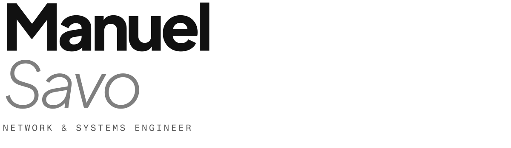

<picture>
  <source media="(prefers-color-scheme: dark)" srcset="assets/banner-dark.svg">
  
</picture>

I scope, architect, and personally build networks and infrastructure: firewall policy, switching and wireless, Windows Server and virtualization, cloud and automation. I also write software, usually to solve a problem in my own lab or DJ setup properly.

Based in Chicago. Available for full-time roles, consulting, and freelance work.

[manuelsavo.com](https://manuelsavo.com) · [LinkedIn](https://www.linkedin.com/in/manuelsavolainen)

### Projects

| Project | About |
|---|---|
| **[Maschine MK3 Traktor Controller](https://manuelsavo.com/projects/mk3-traktor-controller/)** | A Maschine MK3 turned into a full Traktor Pro 4 DJ surface: both screens driven over raw USB with live waveforms and deck state read from inside Traktor. |
| **[TradeSphere](https://manuelsavo.com/projects/tradesphere/)** | A self-hosted, containerized market data and quant research platform with self-healing ingestion, second-by-second bars, and a fail-closed risk gate in front of paper trading. |
| **[FileHost](https://manuelsavo.com/projects/filehost/)** | A self-hosted file service with role-based access, scoped API keys, share links, folders, and Microsoft Defender scanning of every upload before release. |
| **[3D House Explorer](https://manuelsavo.com/projects/patina-and-arch/)** | An interactive 3D house drawn from architectural permit plans, rendered with WebGL and an SVG fallback, built for the Patina & Arch website. |
| **[AI Agent Portal](https://manuelsavo.com/projects/agentic-portal/)** | Runs Claude Code, Codex, and OpenCode headless on an Ubuntu server, with live browser terminals, shared tools over MCP, and failover between AI providers. |
| **[Home Lab](https://manuelsavo.com/projects/home-lab/)** | Hyper-V on 10G, Active Directory, an OPNsense edge with a DMZ, public sites through Cloudflare tunnels, Docker workloads, and automated backups. |

Source code for each project is being cleaned up, packaged, and published here.

### Toolbox

- **Networking:** Cisco FTD, Sophos XGS, SonicWall, pfSense, Meraki, UniFi, Ruckus, Aruba
- **Systems:** Windows Server, Active Directory, Hyper-V, VMware ESXi, IIS
- **Cloud and automation:** Azure, Microsoft 365, Power Platform, PowerShell, Cloudflare
- **Software:** Python, Swift, JavaScript, WebGL, Docker
- **MSP tools:** ConnectWise, CW Automate, Auvik

### Certifications and education

Microsoft AZ-900, MS-900, and PL-200 · BS in Computer Science at DePaul University (in progress)
