<picture>
  <source media="(prefers-color-scheme: dark)" srcset="assets/hero-dark.svg">
  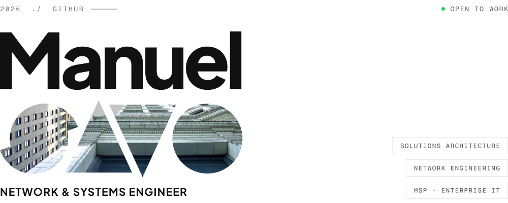
</picture>

I design and build end-to-end networking and infrastructure solutions for businesses across the Chicago area, from firewall architecture and VLAN design to switching refreshes and cloud platform migrations. I also write software, usually to solve a problem in my own lab or DJ setup properly. BS Computer Science student at DePaul University.

<picture>
  <source media="(prefers-color-scheme: dark)" srcset="assets/ticker-dark.svg">
  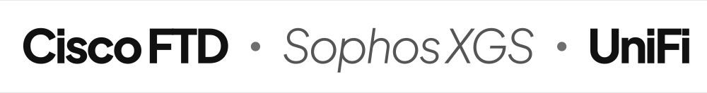
</picture>

<picture>
  <source media="(prefers-color-scheme: dark)" srcset="assets/numbers-dark.svg">
  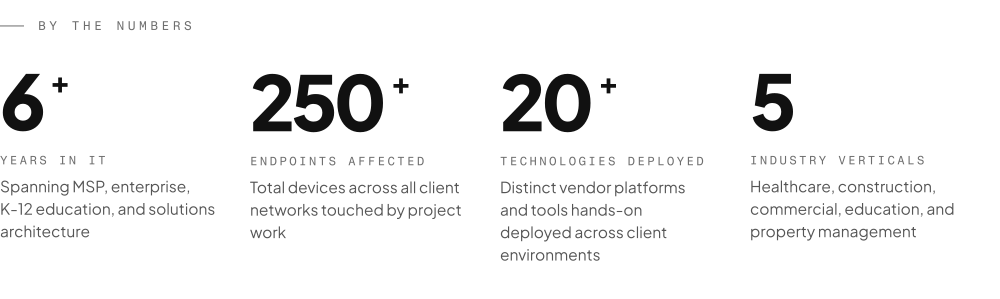
</picture>

<picture>
  <source media="(prefers-color-scheme: dark)" srcset="assets/label-projects-dark.svg">
  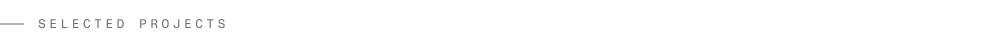
</picture>
<a href="https://manuelsavo.com/projects/patina-and-arch/">
<picture>
  <source media="(prefers-color-scheme: dark)" srcset="assets/project-01-dark.svg">
  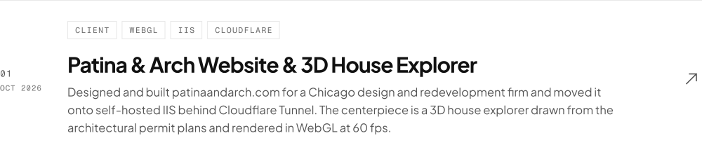
</picture>
</a>
<a href="https://manuelsavo.com/projects/mk3-traktor-controller/">
<picture>
  <source media="(prefers-color-scheme: dark)" srcset="assets/project-03-dark.svg">
  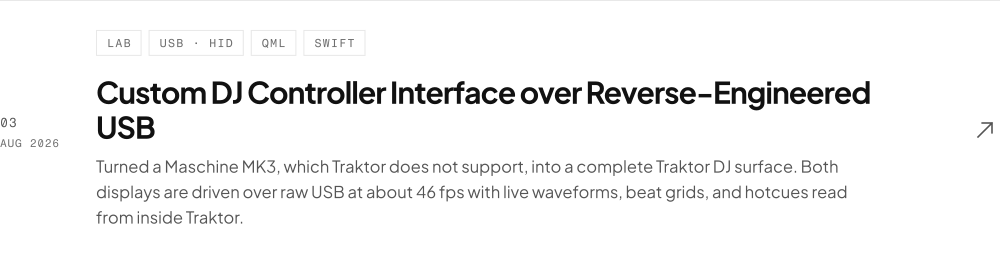
</picture>
</a>
<a href="https://manuelsavo.com/projects/tradesphere/">
<picture>
  <source media="(prefers-color-scheme: dark)" srcset="assets/project-04-dark.svg">
  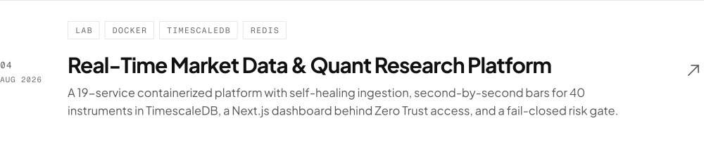
</picture>
</a>
<a href="https://manuelsavo.com/projects/mdf-rebuild/">
<picture>
  <source media="(prefers-color-scheme: dark)" srcset="assets/project-05-dark.svg">
  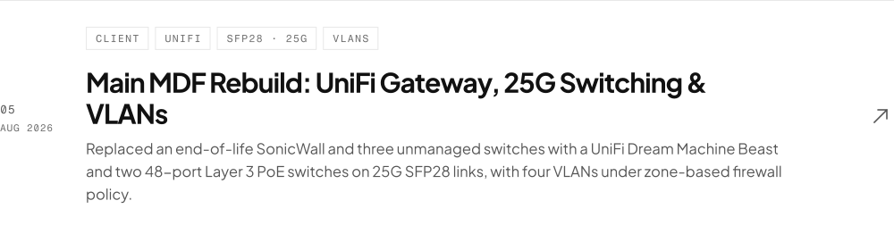
</picture>
</a>
<a href="https://manuelsavo.com/projects/private-llm-platform/">
<picture>
  <source media="(prefers-color-scheme: dark)" srcset="assets/project-09-dark.svg">
  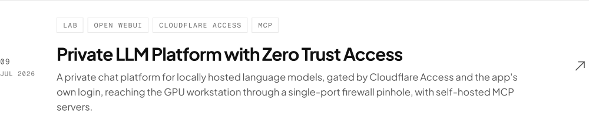
</picture>
</a>
<a href="https://manuelsavo.com/projects/building-network/">
<picture>
  <source media="(prefers-color-scheme: dark)" srcset="assets/project-10-dark.svg">
  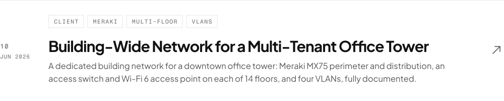
</picture>
</a>
<a href="https://manuelsavo.com/#work">
<picture>
  <source media="(prefers-color-scheme: dark)" srcset="assets/all-projects-dark.svg">
  
</picture>
</a>

Source code for these projects is being cleaned up, packaged, and published here.

<picture>
  <source media="(prefers-color-scheme: dark)" srcset="assets/label-software-dark.svg">
  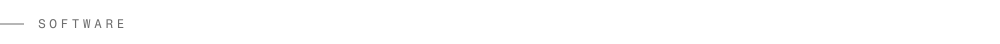
</picture>
<a href="https://studiosavo.com">
<picture>
  <source media="(prefers-color-scheme: dark)" srcset="assets/studio-dark.svg">
  
</picture>
</a>

<picture>
  <source media="(prefers-color-scheme: dark)" srcset="assets/label-certs-dark.svg">
  
</picture>
<picture>
  <source media="(prefers-color-scheme: dark)" srcset="assets/certs-dark.svg">
  
</picture>

<picture>
  <source media="(prefers-color-scheme: dark)" srcset="assets/label-contact-dark.svg">
  
</picture>

  <a href="https://manuelsavo.com"><picture>
  <source media="(prefers-color-scheme: dark)" srcset="assets/btn-site-dark.svg">
  
</picture></a>
  <a href="https://studiosavo.com"><picture>
  <source media="(prefers-color-scheme: dark)" srcset="assets/btn-studio-dark.svg">
  
</picture></a>
  <a href="https://www.linkedin.com/in/manuelsavolainen"><picture>
  <source media="(prefers-color-scheme: dark)" srcset="assets/btn-linkedin-dark.svg">
  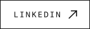
</picture></a>

